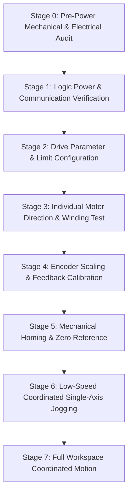

# Physical Commissioning Workflow & Procedures

## 1. Overview and Safety Prerequisites

Physical commissioning is the structured, step-by-step transition from offline simulation to physical hardware execution. 

> **MANDATORY SAFETY WARNING:**
> Never energize motor drives or initiate motion without an independent, hardwired Emergency Stop (E-Stop) within operator reach. Software buttons or network commands are NEVER a substitute for hardware power disconnection.

---

## 2. Commissioning Stage Sequence



---

## 3. Detailed Stage Procedures

### Stage 0: Pre-Power Mechanical & Electrical Audit
1. **Mechanical Inspection:**
   - Confirm all 4 corner frame anchors are securely torqued to extrusion members.
   - Inspect spool drums for burrs, sharp edges, or cable snags.
   - Confirm anti-rotation linear guide rails slide freely with zero binding.
   - Verify cable lines-of-action clear all frame brackets and do not cross.
2. **Electrical Wiring:**
   - Check motor phase wiring against drive terminal diagrams.
   - Verify DC bus polarity (+V and GND) before connecting main power supply.
   - Test continuity of the hardwired E-Stop contactor: depressing E-Stop must open the coil circuit.

### Stage 1: Logic Power & Communication Verification
1. Apply 5V / 24V **logic power only** (keep high-voltage DC bus OFF).
2. Connect ESP32 to host via USB and launch micro-ROS agent:
   ```bash
   ros2 run micro_ros_agent micro_ros_agent serial --dev /dev/ttyUSB0 -b 115200
   ```
3. Verify firmware state transitions to `CONNECTED`.
4. Send test ping or query drive status registers. Confirm zero communication dropouts over 5 minutes.

### Stage 2: Drive Parameter & Limit Configuration
1. Connect to drive configuration tool (vendor USB/serial interface).
2. Set drive hardware current limits to conservative commissioning values (e.g., $30\%$ of continuous rating).
3. Set hardware overspeed limits to $150\text{ RPM}$.
4. Enable drive-level fault outputs (overcurrent, stall, encoder loss, tracking error).

### Stage 3: Individual Motor Direction & Winding Test
1. Disconnect cables from end-effector platform (leave spools unloaded with manual tension).
2. Energize DC bus with E-Stop ready.
3. Command Motor 1 to rotate at $5\text{ RPM}$ for 1 turn in the positive command direction:
   - Observe spool rotation: positive command MUST reel in cable (shorten length).
   - If spool pays out cable, invert the `direction_inverted: true` flag in `config/robot_config.yaml`.
4. Repeat individually for Motor 2, Motor 3, and Motor 4.

### Stage 4: Encoder Scaling & Feedback Calibration
1. Attach a precision digital caliper or tape measure to a free cable end.
2. Command 5 revolutions of the motor.
3. Measure actual cable payout $\Delta l$:
   $$\Delta l_{\text{measured}} \stackrel{?}{=} 5 \cdot (2 \pi r_{\text{spool}}) = 5 \cdot 62.83\text{ mm} = 314.16\text{ mm}$$
4. Calculate effective spool drum radius $r_{\text{eff}} = \frac{\Delta l_{\text{measured}}}{5 \cdot 2\pi}$.
5. Update `nominal_spool_radius_m` in configuration with calibrated value.

### Stage 5: Mechanical Homing & Zero Reference
1. Position platform at the physical geometric center of the frame:
   $$X = 0.000\text{ m}, \quad Y = 0.000\text{ m}$$
2. Verify with cross-hair laser or mechanical alignment jig against frame fiducials.
3. Calculate theoretical cable lengths at origin:
   - $l_1 = l_2 = l_3 = l_4 = \sqrt{(0.250 - 0.050)^2 + (0.200 - 0.040)^2} = \sqrt{0.200^2 + 0.160^2} = 0.25612\text{ m}$ ($256.12\text{ mm}$).
4. Zero encoder counters or set home offset registers in firmware.
5. Transition homing status in backend from `UNREFERENCED` to `HOMED`.

### Stage 6: Low-Speed Coordinated Single-Axis Jogging
1. Attach all 4 cables to platform with nominal pretension ($10\text{ N}$).
2. Start backend and web interface in `HARDWARE` mode.
3. Command a tiny bounded jog: $\Delta X = +10.0\text{ mm}$ at $v = 10\text{ mm/s}$:
   - Verify all 4 winches move smoothly without slackening or binding.
   - Verify estimated position from forward kinematics matches target within $\pm 0.5\text{ mm}$.
4. Command $\Delta X = -10.0\text{ mm}$ back to center.
5. Repeat for $\Delta Y = \pm 10.0\text{ mm}$.

### Stage 7: Full Workspace Coordinated Motion
1. Increase speed incrementally: $25\text{ mm/s} \rightarrow 50\text{ mm/s} \rightarrow 100\text{ mm/s}$.
2. Test waypoints along the safe envelope boundary ($X = \pm 180\text{ mm}, Y = \pm 140\text{ mm}$).
3. Continuously monitor motor temperatures, cable tracking error, and static tension distribution.

---

## 4. Abort Criteria

Stop testing immediately if:
- Any cable develops visible slack ($T < 2\text{ N}$).
- Motor current spikes above continuous threshold ($T > 0.4\text{ Nm}$).
- Tracking error $\|\mathbf{p}_{\text{target}} - \hat{\mathbf{p}}\|$ exceeds $5.0\text{ mm}$.
- Drive alarm line triggers or firmware watchdog trips.
