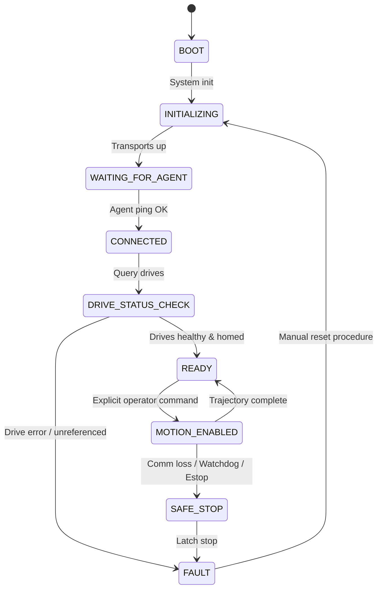

# micro-ROS & ESP32 Embedded Setup Guide: Ubuntu 24.04 (Jazzy) & Ubuntu 22.04 (Humble)

## 1. Embedded Firmware Overview

The embedded subsystem lives in `firmware/esp32_micro_ros/`. It provides an isolated, low-overhead micro-ROS client designed to execute on an Espressif ESP32 SoC.

The ESP32 communicates with the host computer (running the micro-ROS Agent). Since physical servo drives, feedback encoders, and STO circuits are currently unverified, the servo driver interface operates as a fail-closed stub: motor torque remains strictly software-disabled and feedback telemetry is explicitly flagged as unavailable.

---

## 2. Hardware Compatibility & Toolchain Matrix

In accordance with Rule 0.2 (no invented hardware specifications), hardware targets and toolchain versions are categorized by verification status:

| Item | Target / Recommendation | Verification Status | Notes |
|---|---|---|---|
| **MCU Model** | ESP32-WROOM-32D / ESP32-S3 | **Unverified / Provisional** | Standard dual-core Xtensa @ 240 MHz. |
| **Host Environment** | Ubuntu 24.04 LTS (Python 3.12) / Ubuntu 22.04 LTS | **Documented Target** | Tested on development host. |
| **ESP-IDF Version** | ESP-IDF v5.1.x / v5.2.x | **Compatible Reference** | Required for Python 3.12 compatibility on Ubuntu 24.04. |
| **micro-ROS Component** | `micro_ros_espidf_component` (`jazzy` or `humble` branch) | **Compatible Reference** | Branch must match host ROS 2 distribution. |
| **Host ROS 2 Distribution** | ROS 2 Jazzy (Ubuntu 24.04) / ROS 2 Humble (Ubuntu 22.04) | **Supported Distributions** | Primary target is Jazzy. |
| **Transport** | UART / USB-Serial @ 115200 or 921600 baud | **Default Recommended** | Preferred over Wi-Fi for determinism. |
| **Secondary Transport** | Wi-Fi UDP (Static IP recommended) | **Alternative** | Subject to wireless jitter and packet drop. |
| **Servo Drives** | 4x Closed-Loop Servo Drives | **UNKNOWN / Unverified** | Exact protocol (CANopen, Modbus, Step/Dir) pending. |

> **Critical Ubuntu 24.04 Toolchain Notice:** Ubuntu 24.04 ships with Python 3.12. ESP-IDF v4.x is incompatible with Python 3.12 due to the removal of `distutils`. Use ESP-IDF v5.1.2 or newer.

---

## 3. Firmware Architecture & Finite State Machine (FSM)

The firmware enforces a strict state machine implemented in `main/app_state.h`:



### Safety Rules Enforced by Firmware:
1. **Never Auto-Arm:** Reconnecting to the micro-ROS Agent after communication loss transitions to `CONNECTED` or `SAFE_STOP`, **never** to `MOTION_ENABLED`.
2. **Watchdog Timer:** A 250 ms hardware/software watchdog triggers a `SAFE_STOP` and zeros motor commands if valid setpoints cease.
3. **Boundary Envelopes:** Cable displacement and velocity setpoints exceeding configured limits are immediately dropped and reported as faults.

---

## 4. Building and Flashing the Firmware

### 4.1 Prerequisites (Ubuntu 24.04 Host)
1. Install ESP-IDF v5.1+ dependencies and clone ESP-IDF:
   ```bash
   sudo apt update && sudo apt install -y \
       git wget flex bison gperf python3 python3-pip python3-venv \
       cmake ninja-build ccache libffi-dev libssl-dev dfu-util libusb-1.0-0
   
   mkdir -p ~/esp
   cd ~/esp
   git clone -b v5.1.2 --recursive https://github.com/espressif/esp-idf.git
   cd esp-idf
   ./install.sh esp32
   source export.sh
   ```

2. Clone micro-ROS component matching your ROS 2 distribution:
   ```bash
   cd rosoff/firmware/esp32_micro_ros
   
   # For ROS 2 Jazzy (Ubuntu 24.04):
   git clone -b jazzy https://github.com/micro-ROS/micro_ros_espidf_component.git components/micro_ros_espidf_component
   
   # (Or for ROS 2 Humble):
   # git clone -b humble https://github.com/micro-ROS/micro_ros_espidf_component.git components/micro_ros_espidf_component
   ```

### 4.2 Configuration
```bash
idf.py set-target esp32
idf.py menuconfig
```
Configure:
- **micro-ROS Settings:**
  - Transport: UART or WiFi.
  - If WiFi: Set SSID and Pre-Shared Key (Do NOT commit credentials to git!).
  - If UART: Select UART port (UART0 or UART2) and baud rate (default 115200).
- **FreeRTOS:** Set tick rate to 1000 Hz.

### 4.3 Build and Flash
```bash
# Build firmware
idf.py build

# Flash to connected ESP32 (e.g., /dev/ttyUSB0 on Linux or COM3 on Windows)
idf.py -p /dev/ttyUSB0 flash monitor
```

---

## 5. Starting the micro-ROS Host Agent

The host computer bridges micro-ROS serial/UDP packets into standard ROS 2 topics.

### 5.1 Using Docker (Recommended for Jazzy on Ubuntu 24.04)
```bash
# For ROS 2 Jazzy:
docker run -it --rm --net=host --privileged -v /dev:/dev \
    microros/micro-ros-agent:jazzy \
    serial --dev /dev/ttyUSB0 -b 115200

# Over UDP/Wi-Fi:
docker run -it --rm --net=host \
    microros/micro-ros-agent:jazzy \
    udp4 --port 8888
```

*(For Humble: substitute image tag `microros/micro-ros-agent:humble`)*

### 5.2 Building micro-ROS Agent from Source in ROS 2 Jazzy
If Docker is not used, build the agent in your ROS 2 workspace:
```bash
source /opt/ros/jazzy/setup.bash
mkdir -p ~/microros_ws/src
cd ~/microros_ws/src
git clone -b jazzy https://github.com/micro-ROS/micro-ROS-Agent.git
cd ~/microros_ws
colcon build
source install/setup.bash
ros2 run micro_ros_agent micro_ros_agent serial --dev /dev/ttyUSB0 -b 115200
```

---

## 6. Diagnostics & Verification Workflow

### Test Step 1: Agent Handshake
1. Start micro-ROS Agent on host.
2. Power cycle the ESP32.
3. Observe monitor log:
   ```text
   [CDPR_FW] Booting CDPR micro-ROS client...
   [CDPR_FW] Initializing micro-ROS transport...
   [CDPR_FW] Waiting for micro-ROS agent...
   [CDPR_FW] Agent connected!
   ```

### Test Step 2: Topic Inspection
On the host terminal, verify the micro-ROS topics appear in ROS 2:
```bash
ros2 topic list
```
Expected output includes:
- `/cdpr/firmware/state`
- `/cdpr/firmware/diagnostics`
- `/cdpr/command/cables`

### Test Step 3: Watchdog Verification
Disconnect the USB cable or stop setpoint publishing while in motion. Confirm within 250 ms that the firmware enters `SAFE_STOP`, de-energizes drives, and latches a fault state.
